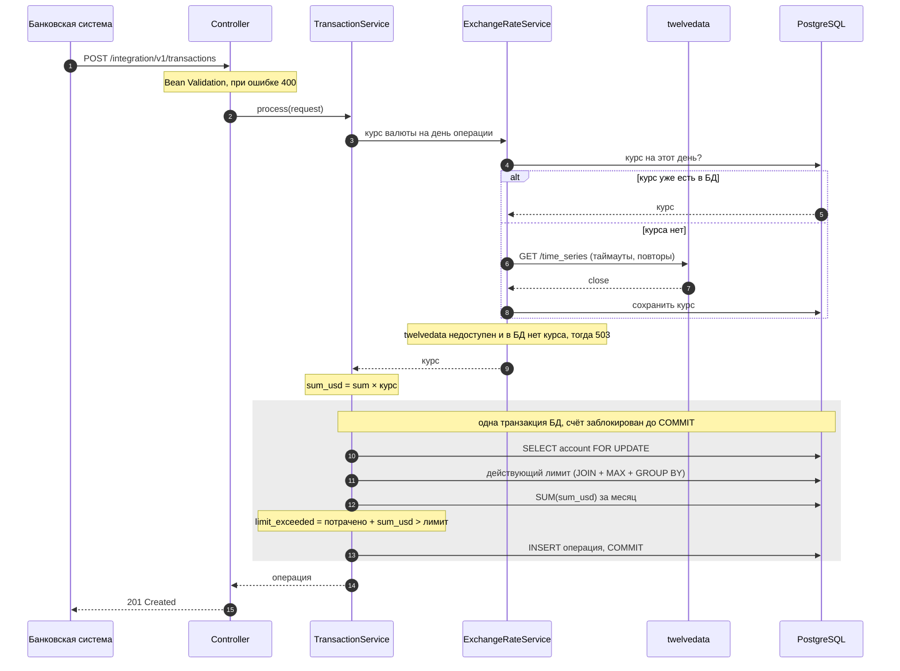
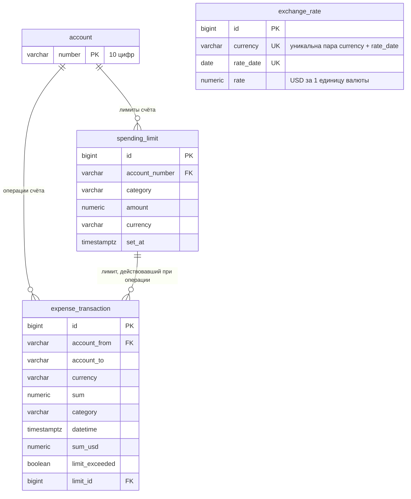

# Expense Tracker

[](https://github.com/L1mir/exspense-tracker/actions/workflows/ci.yml)


Прототип банковского микросервиса для контроля месячных лимитов расходов.
Сервис принимает расходные операции в любой валюте (KZT, RUB, …), переводит их в доллары по биржевому курсу
на день операции и помечает операции, которые вывели клиента за месячный лимит (`limit_exceeded`).

- **Два REST API:** интеграционный (банковские системы присылают операции) и клиентский (лимиты и список превышений).
- **Отдельный лимит** на товары (`product`) и услуги (`service`) в USD, по умолчанию 1000 USD.
- **Курсы валют** берутся с [twelvedata.com](https://twelvedata.com/docs#time-series) и хранятся в своей БД:
  за каждый курс платим один раз.
- **Корректно при параллельных запросах:** два одновременных запроса не увидят один и тот же остаток лимита.

## Содержание

- [Быстрый старт](#быстрый-старт)
- [API](#api)
- [Как считается лимит](#как-считается-лимит)
- [Курсы валют и сбои внешнего API](#курсы-валют-и-сбои-внешнего-api)
- [Часовой пояс](#часовой-пояс)
- [Параллельные запросы](#параллельные-запросы)
- [Мониторинг](#мониторинг)
- [Архитектура](#архитектура)
- [Тесты](#тесты)
- [Допущения и ограничения](#допущения-и-ограничения)
- [Оценка трудоёмкости](#оценка-трудоёмкости)
- [AI в проекте](#ai-в-проекте)

## Быстрый старт

Понадобится бесплатный API-ключ [twelvedata.com](https://twelvedata.com/pricing): зарегистрируйтесь
(тариф Basic, $0) и скопируйте ключ из личного кабинета. Ключ — секрет, поэтому в репозитории его нет:
сервис берёт его из переменной окружения `TWELVEDATA_API_KEY`.

### Вариант 1: всё в Docker, одной командой

Нужен только Docker.

1. Склонируйте репозиторий и перейдите в его папку:
   ```bash
   git clone https://github.com/L1mir/exspense-tracker.git && cd exspense-tracker
   ```
2. Создайте в корне проекта файл `.env` с одной строкой (docker compose читает его сам, а git его игнорирует):
   ```
   TWELVEDATA_API_KEY=ваш_ключ
   ```
3. Запустите:
   ```bash
   docker compose up --build
   ```

Поднимутся PostgreSQL и сервис. Сервис стартует, только когда БД готова, а сам считается готовым, когда
`/actuator/health` отвечает `UP`. Образ собирается в два этапа ([`Dockerfile`](Dockerfile)): jar собирается в
образе с JDK, а запускается в лёгком образе с JRE под непривилегированным пользователем.

### Вариант 2: для разработки

Нужны JDK 21+ и Docker.

1. Поднимите только PostgreSQL:
   ```bash
   docker compose up -d postgres
   ```
2. Запустите приложение (схему БД создаст Flyway при старте) одним из способов:
   - **IntelliJ IDEA:** запустите `ExpenseTrackerApplication`, а ключ задайте в
     Run → Edit Configurations → Modify options → Environment variables: `TWELVEDATA_API_KEY=ваш_ключ`;
   - **из терминала** — задайте переменную и запустите Maven:

     | Терминал | Команды |
     |---|---|
     | bash / zsh (Linux, macOS, Git Bash) | `export TWELVEDATA_API_KEY=ваш_ключ` → `./mvnw spring-boot:run` |
     | PowerShell | `$env:TWELVEDATA_API_KEY="ваш_ключ"` → `.\mvnw.cmd spring-boot:run` |

     Переменная действует только в этом окне терминала.

Swagger UI: **http://localhost:8080/swagger-ui.html** (в правом верхнем углу переключатель между двумя API).

**Тесты** (нужен только запущенный Docker, ключ не нужен):

```bash
./mvnw verify
```

<details>
<summary><b>Попробовать через curl</b></summary>

```bash
# Установить лимит 30 USD на товары
curl -X POST http://localhost:8080/client/v1/accounts/0000000123/limits \
  -H "Content-Type: application/json" \
  -d '{"expense_category": "product", "limit_sum": 30}'

# Отправить две операции в тенге (вторая превысит лимит).
# Время операции — текущее: лимит действует только для операций после его установки.
NOW=$(date -u +%Y-%m-%dT%H:%M:%SZ)

curl -X POST http://localhost:8080/integration/v1/transactions \
  -H "Content-Type: application/json" \
  -d '{"account_from": "0000000123", "account_to": "9999999999", "currency_shortname": "KZT",
       "sum": 10000.45, "expense_category": "product", "datetime": "'$NOW'"}'

curl -X POST http://localhost:8080/integration/v1/transactions \
  -H "Content-Type: application/json" \
  -d '{"account_from": "0000000123", "account_to": "9999999999", "currency_shortname": "KZT",
       "sum": 5000, "expense_category": "product", "datetime": "'$NOW'"}'

# Операции, превысившие лимит
curl http://localhost:8080/client/v1/accounts/0000000123/transactions/exceeded
```

</details>

### Конфигурация

| Переменная окружения | Зачем | По умолчанию |
|---|---|---|
| `TWELVEDATA_API_KEY` | ключ API курсов валют | — (без него приложение не стартует) |
| `SPRING_DATASOURCE_URL` / `_USERNAME` / `_PASSWORD` | подключение к БД вне локальной среды | БД из `docker-compose.yml` |
| `SPRING_PROFILES_ACTIVE` | `dev` (подробные логи) или `prod` (JSON-логи в формате ECS) | `dev`, в Docker — `prod` |

Остальные настройки лежат в [`application.yaml`](src/main/resources/application.yaml), в секции `app`:
часовой пояс, лимит по умолчанию, таймауты и повторы запросов к twelvedata.

## API

| | Метод и путь | Что делает |
|---|---|---|
| **A. Интеграция** | `POST /integration/v1/transactions` | принять расходную операцию |
| **Б. Клиент** | `POST /client/v1/accounts/{account}/limits` | установить новый лимит (дата всегда текущая) |
| | `GET /client/v1/accounts/{account}/limits` | все лимиты счёта, новые сверху |
| | `GET /client/v1/accounts/{account}/transactions/exceeded` | операции, превысившие лимит, с данными этого лимита |

Полное описание с примерами — в Swagger UI.

<details>
<summary><b>Пример: операция → ответ</b></summary>

```json
POST /integration/v1/transactions
{
  "account_from": "0000000123",
  "account_to": "9999999999",
  "currency_shortname": "KZT",
  "sum": 10000.45,
  "expense_category": "product",
  "datetime": "2022-01-30T00:00:00+06:00"
}
```
```json
201 Created
{
  "id": 1,
  "account_from": "0000000123",
  "account_to": "9999999999",
  "currency_shortname": "KZT",
  "sum": 10000.45,
  "expense_category": "product",
  "datetime": "2022-01-30T00:00:00+06:00",
  "sum_usd": 23.00,
  "limit_exceeded": false
}
```

</details>

<details>
<summary><b>Пример: список превышений</b></summary>

```json
GET /client/v1/accounts/0000000123/transactions/exceeded
[
  {
    "account_from": "0000000123",
    "account_to": "9999999999",
    "currency_shortname": "USD",
    "sum": 600.00,
    "expense_category": "product",
    "datetime": "2022-01-03T12:00:00+06:00",
    "limit_sum": 1000.00,
    "limit_datetime": "2022-01-01T00:00:00+06:00",
    "limit_currency_shortname": "USD"
  }
]
```

</details>

<details>
<summary><b>Ошибки: единый формат ProblemDetail (RFC 9457)</b></summary>

Входные данные проверяет Bean Validation: счёт — 10 цифр, валюта — код ISO 4217, сумма больше 0 и не больше
2 знаков после точки, категория `product`/`service`, дата с часовым поясом.

```json
400 Bad Request
{
  "title": "Invalid request",
  "status": 400,
  "detail": "Request validation failed",
  "instance": "/integration/v1/transactions",
  "errors": {
    "account_from": "must be 10 digits",
    "sum": "must be greater than 0"
  }
}
```

| Код | Когда |
|---|---|
| `400` | неверные данные, со списком полей в `errors`. В том числе несуществующая валюта: код проверяется по списку ISO 4217 (`@IsoCurrency`), а не только по формату |
| `503` | нет курса валюты: внешний API недоступен, и в БД нет ни одного курса этой валюты (см. ниже) |
| `500` | непредвиденная ошибка; подробности только в логах |

</details>

## Как считается лимит

```
остаток = действующий лимит − всё потраченное в этой категории за календарный месяц
```

- **Действующий лимит** — последний лимит, установленный **не позже** момента операции.
  Новый лимит не влияет на флаги операций, совершённых до него.
- **Новый лимит не обнуляет потраченное:** при смене лимита в середине месяца уже потраченное учитывается.
- **`limit_exceeded = true`**, только если остаток после операции **меньше нуля**. Ровно 0 — ещё не превышение.
- **Лимит по умолчанию** (1000 USD) сохраняется в БД с датой первой операции. Поэтому его, как и любой
  другой, можно показать в списке превышений.
- Лимиты только добавляются, существующие не изменяются. Дату лимита ставит сервер, клиент её не передаёт.

«1 случай» из задания, его повторяет сквозной тест [`Case1EndToEndIT`](src/test/java/org/limir/expensetracker/Case1EndToEndIT.java):

| Событие | Остаток, USD | `limit_exceeded` |
|---|---:|:---:|
| 01.01 лимит 1000 | 1000 | |
| 02.01 операция 500 | 500 | false |
| **03.01 операция 600** | **−100** | **true** |
| 10.01 лимит 2000 | 900 | |
| 11.01 операция 100 | 800 | false |
| 12.01 операция 700 | 100 | false |
| 13.01 операция 100 | 0 | false |
| **13.01 операция 100** | **−100** | **true** |

Список превышений вернёт операции **3 и 13 января**: первая превысила лимит 1000 USD от 01.01, вторая — 2000 USD от 10.01.

## Курсы валют и сбои внешнего API

```
курс валюты на день операции
  1. USD?                      → 1
  2. есть в нашей БД?          → берём из БД (бесплатно и быстро)
  3. нет → twelvedata          → сохраняем в БД
  4. twelvedata не ответил?    → последний известный курс из БД на более раннюю дату
  5. и такого нет              → 503, операция не сохраняется
```

- **Курс закрытия на день операции.** Запрос `time_series?symbol=USD/KZT&interval=1day&end_date=<день>&outputsize=1`
  возвращает последний `close` на этот день или раньше. Поэтому в выходные и праздники автоматически берётся
  предыдущее закрытие (`previous_close`).
- **Пара переворачивается.** У twelvedata нет `KZT/USD`, есть `USD/KZT`, поэтому курс считается как
  `1 / close`: 1 / 452.7 = 0.0022 USD за тенге. Так работает любая валюта.
- **Таймауты:** соединение 2 с, ответ 5 с. Медленный API не держит приём операций.
- **Повторы:** 2 повтора с паузой 500 мс → 1 с, только при таймаутах, обрывах и ответах 5xx
  (Spring `@Retryable`). Неверный ключ или неизвестную валюту не повторяем: это бесполезно.
- twelvedata может вернуть ошибку с HTTP 200 и `"status": "error"` в теле, поэтому статус проверяется всегда.

**Параллельная загрузка курсов.** При старте и каждый день в 00:05 по Алматы
[`RatePrefetchService`](src/main/java/org/limir/expensetracker/service/RatePrefetchService.java) заранее загружает
курсы валют из `app.rate-prefetch.currencies` (KZT, RUB) на сегодня. Валюты грузятся **одновременно**, по
виртуальному потоку на каждую (`CompletableFuture.supplyAsync` + `Executors.newVirtualThreadPerTaskExecutor()`),
поэтому общее время примерно равно одному запросу. Ошибка одной валюты не мешает остальным. Операции дня потом
сразу находят курс в БД и не ждут внешний API.

**Почему данные не теряются.** Курс получается **до** сохранения операции. Если курса нет совсем, сервис
отвечает `503 Service Unavailable` и ничего не сохраняет. Отправитель (банковская система) повторяет запрос
позже, как это принято в интеграциях. Полусохранённых операций без суммы в USD не бывает. Ситуация возможна
только при первой операции в новой валюте, пока API недоступен: в остальных случаях срабатывает
fallback на последний известный курс.

## Часовой пояс

**Границы месяца и «день операции» определяются в поясе `Asia/Almaty`.**

- Банк и примеры в задании казахстанские (`+06:00`, KZT). Операция 1 февраля в 00:30 по Алматы относится
  к февралю, хотя по UTC это ещё 31 января.
- Используется именно `ZoneId`, а не фиксированное смещение. В марте 2024 года Казахстан перешёл с UTC+6 на UTC+5,
  и Java сама учитывает, какое смещение действовало в какой год. Поэтому верно считаются и даты 2022 года,
  и сегодняшние.
- В БД время хранится как момент (`timestamptz`) без исходного смещения. В ответах API время отдаётся в
  поясе Алматы: `13:00+03:00` вернётся как `15:00+05:00`, это тот же момент.
- Пояс задаётся одной настройкой `app.time-zone`.

## Параллельные запросы

Операции одного клиента могут приходить одновременно: несколько карт на счёте, автоплатежи, пакетная отправка.

- Spring MVC работает на **виртуальных потоках** (`spring.threads.virtual.enabled: true`).
- Проверка лимита идёт под **блокировкой строки счёта** (`SELECT ... FOR UPDATE`, `@Lock(PESSIMISTIC_WRITE)`)
  внутри одной транзакции БД. Второй запрос того же счёта ждёт, пока первый не сохранит операцию.
- Курс валюты запрашивается **до** блокировки, поэтому медленный внешний API её не удерживает.

Тест [`TransactionLimitIT`](src/test/java/org/limir/expensetracker/service/TransactionLimitIT.java) отправляет
10 одновременных операций по 150 USD при лимите 1000 USD и проверяет, что флаг получили ровно 4.
Без блокировки этот тест падает: все 10 операций видят остаток 1000, и флаг не получает ни одна.

## Мониторинг

Spring Boot Actuator:

| Эндпоинт | Что показывает |
|---|---|
| `GET /actuator/health` | `UP`/`DOWN`, отдельно состояние БД. По нему же docker compose проверяет, что сервис готов |
| `GET /actuator/metrics/http.client.requests` | вызовы twelvedata: количество, общее и максимальное время, статусы (Micrometer собирает их сам) |
| `GET /actuator/metrics/exchange.rate.lookups` | откуда взят курс: тег `source` = `database`, `provider` или `fallback` |

Последняя метрика показывает, сколько платных запросов сэкономил кэш в БД и как часто срабатывает fallback.
Источник курса описан `sealed`-интерфейсом [`RateLookup`](src/main/java/org/limir/expensetracker/service/RateLookup.java),
а тег метрики выбирается через `switch` по типу: компилятор не даст забыть новый вариант.

## Архитектура

Обработка одной операции (`POST /integration/v1/transactions`):



Курс запрашивается **до** транзакции БД, поэтому медленный внешний API не держит блокировку счёта.

### Модель данных

Схема создаётся миграциями Flyway ([`db/migration`](src/main/resources/db/migration)), Hibernate её только проверяет.



Действующий лимит находится SQL-запросом с JOIN на подзапрос с агрегатной функцией и группировкой
([`SpendingLimitRepository`](src/main/java/org/limir/expensetracker/repository/SpendingLimitRepository.java)):

```sql
SELECT l.* FROM spending_limit l
JOIN (SELECT account_number, category, MAX(set_at) AS max_set_at
      FROM spending_limit
      WHERE account_number = :accountNumber AND category = :category AND set_at <= :moment
      GROUP BY account_number, category) latest
  ON l.account_number = latest.account_number
 AND l.category = latest.category
 AND l.set_at = latest.max_set_at
```

### Пакеты

Код разложен по слоям: сервис небольшой, так нужный класс быстрее всего найти.

```
org.limir.expensetracker
├── controller   REST-контроллеры двух API
├── service      бизнес-логика: TransactionService, LimitService, AccountService, ExchangeRateService,
│                RatePrefetchService (параллельная загрузка курсов)
├── repository   Spring Data JPA, native SQL
├── entity       JPA-сущности
├── dto          запросы и ответы API (records)
├── validation   @IsoCurrency: проверка кода валюты по ISO 4217
├── mapper       MapStruct: сущность → DTO
├── client       ExchangeRateProvider и реализация для twelvedata (RestClient + @HttpExchange)
├── exception    GlobalExceptionHandler (ProblemDetail), ExchangeRateUnavailableException
├── config       @ConfigurationProperties, бин Clock, OpenAPI
└── util         MoneyUtils (BigDecimal, HALF_UP), DateTimeUtils (границы месяца)
```

**Стек:** Java 21, Spring Boot 4.1 (Web MVC, Data JPA, Validation), PostgreSQL 17, Flyway, MapStruct, Lombok,
springdoc-openapi, Logbook (логирование HTTP), Actuator + Micrometer, JUnit 5, Mockito, AssertJ, Testcontainers,
WireMock, Docker, GitHub Actions.

## Тесты

`./mvnw verify` запускает 43 теста. Интеграционные поднимают настоящий PostgreSQL в Docker (Testcontainers);
twelvedata в тестах всегда подменён WireMock'ом. Те же тесты гоняет CI на каждый push.

| Тест | Что проверяет |
|---|---|
| [`Case1EndToEndIT`](src/test/java/org/limir/expensetracker/Case1EndToEndIT.java) | «1 случай» целиком через HTTP: приложение на случайном порту, Postgres, WireMock |
| [`TransactionLimitIT`](src/test/java/org/limir/expensetracker/service/TransactionLimitIT.java) | оба случая из задания, остаток ровно 0, новый месяц, лимит по умолчанию, категории, конвертация, параллельность |
| [`ExchangeRateIT`](src/test/java/org/limir/expensetracker/service/ExchangeRateIT.java) | HTTP-клиент twelvedata: переворот курса, ошибка в теле ответа, повтор после 500, таймаут, кэш в БД, fallback, метрика вызовов |
| [`ExchangeRateServiceTest`](src/test/java/org/limir/expensetracker/service/ExchangeRateServiceTest.java) | логика «БД → API → fallback» и метрика источника курса на моках |
| [`RatePrefetchServiceTest`](src/test/java/org/limir/expensetracker/service/RatePrefetchServiceTest.java) | курсы грузятся именно параллельно (мок ждёт, пока стартуют все запросы), ошибка одной валюты не мешает другим |
| [`ExpenseTrackerApplicationIT`](src/test/java/org/limir/expensetracker/ExpenseTrackerApplicationIT.java) | приложение стартует, `/actuator/health` = UP вместе с БД |
| [`*ControllerTest`](src/test/java/org/limir/expensetracker/controller) | JSON-формат, валидация, коды ответов (`@WebMvcTest`) |
| [`MoneyUtilsTest`, `DateTimeUtilsTest`](src/test/java/org/limir/expensetracker/util) | округление, границы месяца, смена смещения Казахстана |

Текущее время в коде берётся только из бина `java.time.Clock`. В тестах он заменён на
[`MutableClock`](src/test/java/org/limir/expensetracker/MutableClock.java), который тест «переводит» на нужную дату.

## Допущения и ограничения

- Операции приходят примерно в хронологическом порядке («в реальном времени»). Флаги ранее сохранённых
  операций не пересчитываются.
- Лимит привязан к счёту клиента (`account_from`) и категории. Авторизации нет, как и требует задание.
- Курс за сегодняшний день сохраняется при первом запросе и больше не уточняется в течение дня.
- Списки не постраничные: у одного счёта записей немного.
- Пока twelvedata недоступен, каждый запрос курса, которого нет в БД, ждёт таймауты и повторы (до ~16 с).
  Следующий шаг — circuit breaker (например, Resilience4j): после серии ошибок сразу идти в fallback.

## Оценка трудоёмкости

Оценка дана до начала работы: задача разбита на этапы, для каждого — диапазон «оптимистично – пессимистично»
для разработки одним junior-разработчиком без AI. Многое в задании было для меня новым, поэтому изучение
вынесено отдельной строкой.

| Этап | Что входит | Оценка |
|---|---|---:|
| Анализ и проектирование | требования, модель данных, API, стратегия при сбоях внешнего API | 2–3 ч |
| Изучение новых технологий | Spring Boot 4, пессимистичные блокировки, Testcontainers, WireMock, `CompletableFuture`, MCP и Agent Skills | 6–10 ч |
| Каркас | Spring Boot, конфигурация и профили, структура пакетов, PostgreSQL, Flyway | 2–4 ч |
| Курсы валют и внешний API | клиент twelvedata, таймауты и повторы, хранение курсов, fallback, previous close | 4–6 ч |
| Лимиты и бизнес-логика | лимиты по категориям, пересчёт в USD, границы месяца в часовом поясе, конкуренция за лимит (блокировки) | 6–9 ч |
| REST API и SQL | приём транзакций, лимиты, список превышений, JOIN с подзапросом и агрегацией, валидация, ProblemDetail | 4–6 ч |
| Тестирование | unit-тесты, Testcontainers, WireMock, сквозной тест «1 случая», тест параллельных запросов | 6–10 ч |
| Документация, AI и инфраструктура | Swagger, README, SKILL.md, MCP, Docker Compose, CI | 5–8 ч |
| **Обязательная часть** | | **35–56 ч, 6–9 рабочих дней** (по 6 продуктивных часов в день) |
| Необязательные пункты | параллельная загрузка курсов, Actuator и метрики, Dockerfile | 4–6 ч |

**Фактически:** 3 дня с AI-агентом, срок выдержан. Агент снял основную часть написания кода: базовая
реализация заняла около одного рабочего дня. Остальное время ушло на то, что за меня AI не сделает: разбор
сгенерированного кода и новых для меня технологий, исправление найденных проблем, проверку соответствия
каждому пункту задания и необязательные пункты.

## AI в проекте

### Инструмент и как использовался

**Claude Code** (приложение Claude Desktop, модель Claude Opus). Я использовал его как исполнителя, а сам работал
в роли ведущего разработчика: ставил задачи, принимал решения, ревьюил и отвечал за результат.

Процесс:

1. **План.** Разобрал задание вместе с агентом, разбил работу на этапы (настройка → схема БД → курсы →
   логика лимитов → API → сквозной тест → AI-обвязка → Docker и мониторинг) и расставил приоритеты так,
   чтобы уложиться в срок: обязательное → полезные пункты со звёздочкой → остальное.
2. **Решение до кода.** На каждом этапе агент сначала показывал модель или алгоритм с вариантами, я выбирал
   или отправлял на доработку. Код появлялся только после моего «ок».
3. **Ревью в IDE.** Все изменения я смотрел как незакоммиченный diff, разбирал непонятные места, проходил
   ключевой сценарий отладчиком и просил переделать то, что считал лишним или непонятным.
4. **Коммиты — только после ревью и по моей команде**, небольшими логическими шагами. Это правило записано
   и для агентов в [`AGENTS.md`](AGENTS.md).

### MCP

Конфигурация в [`.mcp.json`](.mcp.json) (Claude Code), секретов в ней нет.

| Сервер | Зачем |
|---|---|
| **context7** (`@upstash/context7-mcp`) | актуальная документация библиотек. Spring Boot 4 вышел недавно, и в нём многое переехало: `@WebMvcTest` в новый пакет, `RestClient` в отдельный стартер, Jackson 3. Context7 отдаёт документацию именно версий `v4.0`/`v4.1` |
| **postgres** (`@microsoft/postgres-mcp`) | агент видит схему и данные локальной БД под **read-only ролью** `expense_readonly` ([скрипт](docker/postgres/create-readonly-user.sql)). Пароль берётся из переменной окружения `MCP_DB_PASSWORD` |

**Пример, где помог Postgres MCP.** После ручной проверки API через curl я попросил агента сверить через MCP,
что в БД сохранилось то же, что вернул API: суммы в USD, флаги и ссылки на лимиты
(`JOIN expense_transaction ↔ spending_limit`). Агенту не пришлось писать отдельный код для проверки или ходить
в БД через консоль. Попытка `DELETE` через MCP получила `permission denied`, то есть роль действительно только читает.

<details>
<summary><b>Как подключить MCP у себя</b></summary>

1. `docker compose up -d postgres`. На новом томе read-only роль создаётся автоматически; для уже существующего:
   `docker exec -i expense-tracker-postgres psql -U expense -d expense_tracker < docker/postgres/create-readonly-user.sql`
2. Задать переменную окружения `MCP_DB_PASSWORD=readonly` (локальный пароль из скрипта) и перезапустить Claude Code.
3. В `.mcp.json` команды записаны как `cmd /c npx …`: так Claude Code запускает `npx`-серверы на Windows.
   На macOS/Linux вместо `"command": "cmd", "args": ["/c", "npx", …]` используйте `"command": "npx", "args": […]`.

</details>

### Скилл

[`.agents/skills/write-limit-test/SKILL.md`](.agents/skills/write-limit-test/SKILL.md) — как писать тесты на логику
лимитов по конвенциям проекта: куда класть тест, `@IntegrationTest` + `MutableClock`, хелперы `setLimit`/`pay`,
даты с `+06:00`, сценарий построчно с остатком в комментариях, команда запуска.

- Скиллы лежат в `.agents/skills/` (Codex, Cursor, Copilot). Для Claude Code сделан симлинк
  `.claude/skills → .agents/skills`. На Windows для симлинков нужен режим разработчика и `git config core.symlinks true`.
- **Как применять:** агент подхватывает скилл сам по `description`, если попросить что-то вроде
  «напиши тест: лимит 500, две операции по 300, вторая должна превысить». В Claude Code его можно вызвать и явно:
  `/write-limit-test`.
- **Проверка:** в новой сессии Claude Code агент по такому запросу сам загрузил скилл и добавил тест в
  `TransactionLimitIT` строго по конвенциям (хелперы, даты, комментарии с остатком, проверка превышенного лимита).

Общие правила проекта для любых агентов — в [`AGENTS.md`](AGENTS.md). [`CLAUDE.md`](CLAUDE.md) просто подключает его для Claude Code.

### Что написано вручную

Код и тесты писал агент по моим постановкам, сам я вносил только небольшие правки. Моя часть работы —
решения, контроль качества и разбор кода:

**Архитектурные и продуктовые решения** (агент предлагал варианты, выбор и обоснование мои):
- лимит привязан к счёту клиента и категории; границы месяца в `Asia/Almaty`, а не в UTC;
- при недоступном API и отсутствии курса — отказ с `503`, а не статус «ждёт курс» с планировщиком:
  данные не теряются, а лишней сложности нет;
- округление `HALF_UP`; номер счёта — строка, а не число (ведущие нули, формат из ТЗ);
- два API с разными префиксами `/integration` и `/client`, счёт в пути, без пагинации;
- структура пакетов по слоям; `RestClient` для сквозного теста;
- что делать из необязательного: Docker, CI, Actuator и метрики, параллельная загрузка курсов, `AGENTS.md`;
  Redis, свой MCP-сервер и деплой сознательно отложил.

**Контроль качества и правки по ревью:**
- остановил переусложнение конфигурации на старте и попросил оставить одну стандартную схему Spring Boot;
- попросил убрать лишние комментарии и переложить пакеты по слоям, а миграцию и маппинг разнести по
  отдельным коммитам;
- попросил сверить проект с заданием построчно. Так нашлись несуществующая валюта, которая получала `503`
  вместо `400`, и отсутствующий в SQL `GROUP BY` из подсказки задания;
- проверил README «глазами проверяющего»: заметил неотрисованную на GitHub диаграмму и непонятные шаги запуска.

**Разбор кода:** прошёл обработку операции отладчиком от контроллера до сохранения в БД и разобрал, зачем
нужны `TransactionTemplate`, `SELECT ... FOR UPDATE`, `@Retryable`, `CompletableFuture`, Testcontainers и WireMock.

**Окружение:** ключ twelvedata, переменные окружения, конфигурация запуска в IDE, read-only роль для MCP,
режим разработчика Windows для симлинка скилла.

### Где AI ошибся и как это заметили

| Ошибка AI | Как заметили и что сделали |
|---|---|
| Несуществующая валюта (`XYZ`) проходила проверку формата и получала `503 «повторите позже»`: банковская система повторяла бы такой запрос бесконечно | при сверке проекта с заданием, которую я попросил сделать. Добавлена проверка по списку ISO 4217 (`@IsoCurrency`), теперь `400` |
| В SQL действующего лимита не было группировки, хотя подсказка задания прямо говорит про «агрегирующие функции и группировки» | там же, при сверке с заданием. Подзапрос переписан с `GROUP BY` |
| Слишком сложная конфигурация на старте: несколько схем переменных окружения, импорт `.env`, отдельный logback XML | я не смог быстро разобраться в ней на ревью и попросил упростить. Осталась одна стандартная схема Spring Boot |
| Агент добавлял в коммиты строку `Co-Authored-By` (и появился в Contributors на GitHub) и несколько раз коммитил без согласования | я увидел это на GitHub и в IDE: изменения пропадали из diff до ревью. История исправлена, правило «коммит только по запросу» записано в `AGENTS.md` |
| Диаграмма архитектуры не отрисовывалась на GitHub: `;` в тексте Mermaid считается разделителем команд | я заметил ошибку на странице репозитория. Исправлен синтаксис, диаграммы перепроверены рендером |
| При диагностике MCP другая сессия агента предложила `docker compose down -v`, то есть удаление всех локальных данных | я не стал выполнять разрушительную команду и попросил сначала проверить причину: роль в БД была, не хватало переменной `MCP_DB_PASSWORD` |
| Дата в запросе к twelvedata форматировалась по локали Windows: `end_date=03.01.2022` вместо `2022-01-03` | интеграционный тест с WireMock показал фактический запрос. Исправлено явным `@DateTimeFormat(iso = DATE)` |
| Если в контроллере валидируется и путь, и тело, Spring бросает другое исключение, и ошибки полей тела терялись | `@WebMvcTest` ждал `errors.limit_sum` и не нашёл. Обработчик доработан под `ParameterErrors` |
| Сообщения валидации наполовину на русском (по языку системы), наносекунды в дате лимита, `30` вместо `30.00` | ручная проверка API через curl. Зафиксирована локаль `en`, дата округлена до секунд, суммы приведены к 2 знакам |

Общий вывод: AI быстро пишет рабочий код, но без постановки задачи, ревью и проверки по ТЗ легко уходит в
переусложнение и пропускает требования. Поэтому решения и финальная проверка оставались за мной.

## Структура репозитория

```
├── .agents/skills/        скилл для AI-агентов (.claude/skills — симлинк на него)
├── .github/workflows/     CI: сборка и тесты
├── docker/postgres/       read-only роль для MCP
├── src/main/java/…        код сервиса
├── src/main/resources/    application*.yaml, миграции Flyway
├── src/test/java/…        unit-, интеграционные и сквозной тесты
├── .mcp.json              MCP-серверы
├── AGENTS.md              инструкции для AI-агентов
├── Dockerfile             multi-stage сборка образа сервиса
└── docker-compose.yml     сервис + PostgreSQL одной командой
```
